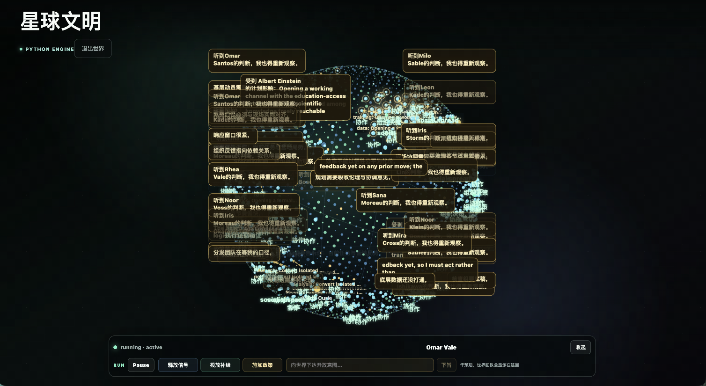
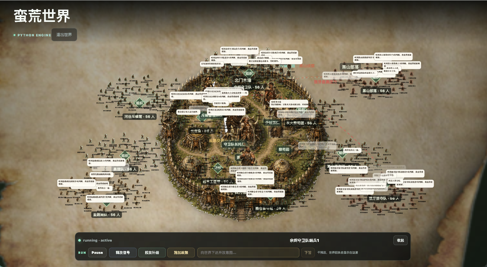
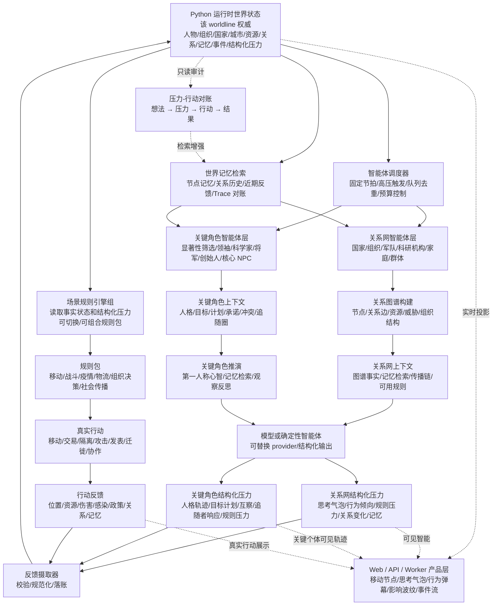

# AI 原生世界引擎 / AI Native World Engine

**一个会自己运转的 AI 原生世界。**

## 这是什么

一个用 Python 写的 AI 原生世界运行引擎。它维护一个持续运转的世界状态：人物、组织、国家、城市、资源、关系、记忆和事件都在世界里。模型（DeepSeek / OpenAI-compatible）只是可替换的认知层，输出结构化的想法、意图和行动倾向；移动、战斗、说话、交易、生存和资源变化由规则引擎裁决，权威行动再写回世界。

仓库包含 Python 引擎、本地 API/Worker 和 Web 查看器，开箱带两个可进入的世界：

- **星球文明**（`enterprise_earth`）：国家、组织关系网、关键角色和匿名人群投影到假设的地球。
- **蛮荒世界**（`tribe_survival`）：8 个我方组织、3 个外部势力、616 名普通成员和 7 名关键人物，在生存规则下持续行动。

引擎不依赖外部数据库或 Web 服务；不接模型也能完整运行，接上模型只是替换认知层。

## 它能做什么

- **AI 原生游戏与 NPC 世界**：居民有目标、记忆和关系，会自己行动；思考气泡、行为弹幕和事件流直接可见，玩家的干预会变成世界后果。
- **关系网与社会推演**：国家、组织、关键角色的压力传播和决策链可观察、可回放、可审计，不是一段黑盒聊天记录。
- **可复现的模型与规则评估**：确定性内核在同一 `scenario + seed + ticks` 下复现同一世界，模型输出单独留档，方便比较不同模型、规则和成本；压力-行动对账提供比“像不像人”更硬的指标。
- **搭自己的 AI 世界**：注册自定义场景、从受治理 JSON catalog 导入世界、替换 Provider，引擎、API/Worker 和查看器都能复用。

## 核心优势

大多数“AI NPC”项目的做法，是给每个角色接一个模型：贵、慢、不可控，模型一句话就能改掉世界。这个项目反过来做——**让世界拥有权威和规则，让模型只在需要的时候参与认知。**

**1. 一次调用，驱动一整轮群体认知。** 关系轮一次输出固定 10 个主动节点的想法与行动选择、最多 12 条关系变化；引擎再把影响扩散到每个主动节点的 3 个关系目标，形成 30 个涟漪节点，并把每条想法切成 6 段时间轴。一次模型调用覆盖 40 个节点、60 条思考切片——不是一人一次调用。

**2. 模型只负责“提建议”，规则才负责“签字”。** 智能体输出只允许 6 类效果：规则压力、关系变化、记忆、思考气泡、行为弹幕、关键角色状态。`node_position`、`node_state`、`world_state`、`resource_transfer` 这类直接改状态的类型会被边界拒绝；移动、战斗、交易必须由规则包生成候选并被裁决。模型写得再漂亮，也不能直接挪动一个节点。

**3. 因果链是机器能对账的数据。** 每条压力都有稳定 `pressure_id`、provider job、来源 tick 和观察截止时间；规则裁决出的行动通过 `caused_by_pressure_ids` 反向绑定压力。引擎维护 pressure-action 与 AI causality 两套账本，把“想法 → 压力 → 行动 → 结果”的匹配、待观察、未兑现都统计出来，再回灌到下一次上下文。

**4. 成本不是事后账单，而是调度约束。** cognition epoch 调度器为关系轮 / 关键角色 / 辅助任务分配车道上限（10 / 5 / 1），同时限制每 tick 启动数、预取窗口、软截止、每日预算、prompt/completion token 和估算成本；高压触发与事件透镜也有每 tick 上限。

**5. 上下文是编译出来的，不是拼字符串。** 每个任务拿到有界上下文包：最多 64 个覆盖节点、16 个详细候选、深度 1 子图（≤32 节点 / 96 边）、8 条记忆、6 条反馈、24 条模型边，外加压力-行动反思、观察反思和关键角色影响链；编译成 `agent_model_context_v2`，记录各段字节数、模板版本和缓存命中，稳定前缀可以复用。

**6. 确定性延伸到了视觉节奏。** 每张关系图固定 10 个主动 + 30 个涟漪时间轴，6 轮、60 秒一分钟、同节点最小间隔 10 秒、0–1 秒抖动，occurrence id 在恢复后仍保持一致。TickCommit 带 checksum，事件、追踪、provider 输出和尝试都有游标，可以从 compact checkpoint 续跑。

**7. 一套契约，两个完全不同的世界。** 星球文明是 595 个主体、1,890 条关系的关系网仿真；蛮荒世界是 8 个我方组织、3 个外部势力、616 名成员和 7 名关键人物的生存仿真。移动、战斗、疫情、隔离、物流、组织决策、社会传播、科研发表、迁徙、协作、生产、经济交换等规则包可以组合。

**8. 模型是可替换的认知层。** 不接模型，确定性 provider 完整跑通；接 DeepSeek / OpenAI-compatible，只换认知层。用户还可以用自然语言下旨，主权意图编译器把旨意编译成 allowlist 内的效果和带触发条件/TTL 的声明式动态规则，再进入同一套裁决。

> 这些不是设计口号，而是写进代码的约束：关系轮少一个节点会被直接拒绝，未兑现的压力会进账本，重复的 tick 有 checksum，超出预算的调度不会启动。

| 维度 | 常见 Agent-first 模拟 | AI 原生世界引擎 |
| --- | --- | --- |
| 世界的基本单位 | 每个 Agent 常驻一个大模型 | 世界状态、规则和关系网 |
| 模型职责 | 直接决定 Agent 行为 | 只写结构化压力，由规则裁决真实行动 |
| 规模 | 几十个 Agent 后成本失控 | 数百到上千 AI 人物，分层智能预算 |
| 可复现性 | 随模型输出漂移 | 确定性内核 `scenario + seed + ticks` 可复现，模型输出留档 |
| 可审计性 | 模型黑盒改状态 | 想法 → 压力 → 行动 → 结果全程可追踪 |
| 状态权威 | Agent 直接改世界 | 规则引擎落账后写回世界 |

## 快速开始

需要 Python 3.11+。

```bash
uv sync --extra dev
uv run python examples/seed_world.py
```

也可以在 Python 里直接推进世界并读取快照：

```python
from ai_native_world_engine import World

world = World.scenario("tribe_survival", seed=7)
for _ in range(3):
    world.step()

snapshot = world.snapshot()
print(snapshot["tick"])
```

`seed` 是确定性冒烟场景，`compound_crisis` 用于验证多条规则同时落地，`catalog` 可以从 JSON 加载一个受治理约束的世界。产品世界是 `enterprise_earth` 和 `tribe_survival`。

## 在浏览器里运行

Web 查看器使用 TypeScript + React + Vite，本地 API 和嵌入式 Worker 由同一个进程提供。首次运行先安装依赖：

```bash
uv sync --project apps/api
cd apps/web && npm install && cd ../..
```

启动本地 demo：

```bash
DEEPSEEK_API_KEY=sk-... python3 scripts/dev_demo.py
```

也可以把 `DEEPSEEK_API_KEY`、`AI_NATIVE_WORLD_DEEPSEEK_MODEL` 等写入 `.env.local`（已被 `.gitignore` 排除）。启动后打开 http://127.0.0.1:5173 ，运行时健康状态位于 http://127.0.0.1:8000/api/health 。不配置密钥时，入口仍可以用本地确定性 Provider 进入世界。

## 两个世界

### 星球文明 `enterprise_earth`

把国家、组织关系网智能体、公开关键角色智能体和匿名/合成人群 cohort 放进同一个可审计世界。组织成员以关系网方式参与协作、协调、舆情、科研和政策决策。

```python
from ai_native_world_engine import World

world = World.scenario("enterprise_earth", seed=7)
print(world.attributes["scene_title"])
print(world.attributes["coverage"]["ordinary_people_model"])
```



治理边界：普通真实个人默认不被直接模拟；普通人以匿名聚合 cohort 或合成代理表示。战争、疫情、政治和公共事件输出只定位为场景模拟和假设推演，不是确定性预测。

### 蛮荒世界 `tribe_survival`

围绕食物、住所、防御、侦察、外交、记忆和士气循环的生存世界。我方组织可以被国王视角指挥；敌方部落是自主势力，只能通过侦察、外交、威慑、战斗和世界事件间接影响。

```python
from ai_native_world_engine import World

world = World.scenario("tribe_survival", seed=7)
print(world.attributes["scene_title"])
print(len(world.nodes))
```



## 架构



Python 运行时持有该 worldline 的权威世界状态；模型和确定性智能体只产出结构化压力，规则引擎组把压力裁决为真实行动，行动反馈再写回世界并进入投影。可视化和产品层只读取投影，不取得状态权威。

## 可复现运行

run harness 把场景、种子、规则包、Provider 和节拍数组织成一次可复现运行：

```python
from ai_native_world_engine.core import RunConfig, run

result = run(RunConfig(scenario="enterprise_earth", seed=7, ticks=2))
report = result.to_dict()

print(report["snapshot"]["tick"])
print(report["pressure_action_report"]["totals"]["match_rate"])
print(report["scorecard"]["score"])
```

默认 Provider 是确定性的本地基线实现。它只输出结构化压力，真实行动仍由规则引擎裁决并通过权威行动反馈落账。`scorecard` 汇总压力兑现率、未兑现压力、世界错误和行动数量。

需要比较多个 seed 或 Provider 配置时，可以使用 experiment matrix：

```python
from ai_native_world_engine.core import (
    ExperimentConfig,
    ExperimentProviderConfig,
    run_experiment,
)

report = run_experiment(
    ExperimentConfig(
        seeds=[7, 23],
        ticks=3,
        providers=[
            ExperimentProviderConfig(name="baseline"),
            ExperimentProviderConfig(name="quiet", provider_params={"emit_thoughts": False}),
        ],
    )
).to_dict()

print(report["summary"]["run_count"])
print(report["leaderboard"][0]["score"])
```

## 接入模型（可选）

引擎不要求模型在线。需要让模型参与思考时，把 JSON LLM 客户端包成 scheduler Provider 即可：

```python
import os

from ai_native_world_engine.core import (
    DeepSeekJsonClient,
    JsonLlmProviderAdapter,
    RunConfig,
    run,
)

provider = JsonLlmProviderAdapter(
    client=DeepSeekJsonClient(
        api_key=os.environ["DEEPSEEK_API_KEY"],
        model="deepseek-flash",
    ),
    allowed_rule_names={"movement", "combat", "speak"},
)

report = run(
    RunConfig(
        scenario="tribe_survival",
        seed=7,
        ticks=8,
        scheduler_provider=provider,
    )
).to_dict()

print(report["scorecard"]["score"])
```

也可以直接运行附带的示例：

```bash
DEEPSEEK_API_KEY=sk-... uv run python examples/live_deepseek_world.py \
  --scenario tribe_survival --ticks 1 --model deepseek-flash
```

支持 `--scenario enterprise_earth|tribe_survival`、`--seed`、`--ticks`、`--model` 和 `--base-url`。模型调用与规则裁决并发进行：`world_tick` 可能大于请求的 `ticks`，因为认知任务排空期间世界时间会继续推进。

`OpenAICompatibleJsonClient` 可以接入其他兼容 Chat Completions 的服务。模型只返回 JSON 结构化压力；解析、校验、规则裁决和状态写回都在引擎内完成。

## 注册自定义场景

应用或外部场景包可以注册世界工厂，不需要修改 `World.scenario()`：

```python
from ai_native_world_engine import World, register_scenario, unregister_scenario


def create_my_world(seed: int = 7) -> World:
    world = World("my-world", {"scenario": "my_world", "seed": seed})
    world.add_node("traveler", "person", "Traveler", (0, 0))
    return world


register_scenario("my_world", create_my_world, aliases=("my-world",))
world = World.scenario("my_world", seed=23)
unregister_scenario("my_world")
```

注册表拒绝意外的名称和别名冲突，只有显式传入 `replace=True` 才会替换已有注册。注册属于进程内扩展，不会自动发现或执行第三方插件。

## 治理型场景导入

受治理约束的世界可以从本地 JSON catalog 导入：

```python
from ai_native_world_engine.core import RunConfig, run

result = run(
    RunConfig(
        scenario="catalog",
        scenario_path="examples/catalogs/enterprise_earth_sample.json",
        ticks=1,
    )
)

print(result.to_dict()["snapshot"]["nodes"][0]["name"])
```

Catalog 导入器会校验治理边界：普通真实个人不能作为未治理 `person` 节点导入；普通人应使用 `population_cohort` 并声明 `privacy: "anonymous_aggregate"`，或明确声明为 synthetic。

## 引擎构成

```text
src/ai_native_world_engine/
  core/       世界状态、规则引擎组、结构化压力、记忆、行动反馈、追踪、投影、run harness
  scenarios/  星球文明、蛮荒世界、seed、复合危机、catalog 导入
apps/api/     本地 API
apps/worker/  嵌入式与独立 Worker
apps/web/     Web 查看器（TypeScript + React + Vite）
scripts/      本地 demo 启动脚本
tests/        引擎测试
examples/     无界面示例与 catalog 样例
docs/images/  世界截图
```

核心闭环：

1. 世界状态与关系网保存在 `World`。
2. 智能体或模型只写结构化压力和解释。
3. 规则引擎组裁决真实行动，生成权威 `ActionFeedback`。
4. 反馈写回状态、记忆、事件和追踪。
5. viewer projection 消费快照、增量和事件，不取得状态权威。

## 测试与检查

```bash
uv run --extra dev pytest -q
uv run --extra dev ruff check src tests examples
```

## 开源边界

本仓库包含 Python 引擎、本地 API/Worker 和 Web 查看器。Godot 同构实现和商业化材料不在仓库中。

## 许可证

[Apache License 2.0](LICENSE)
